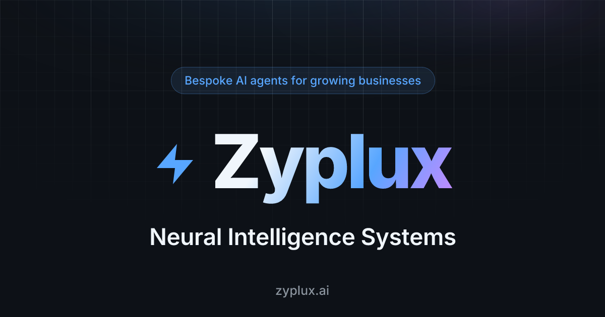

#  zyplux/.github

**The [Zyplux](https://zyplux.ai) org-wide `.github` repo** — the public organization profile, the reusable bot review gate, and the org rulesets as code.

## What's inside

| Piece                                                 | What it is                                                                    |
| ----------------------------------------------------- | ------------------------------------------------------------------------------ |
| [profile/README.md](profile/README.md)                | Public org profile rendered at [github.com/zyplux](https://github.com/zyplux) |
| [org_gate_base](.github/workflows/org_gate_base.yml)  | Reusable workflow gating merges on clean reviews from participating bots                  |
| [bot-review-gate](apps/bot-review-gate)       | The app behind org_gate_base — records the review verdict as a commit status   |
| [review-events](apps/review-events) | Cloudflare Worker forwarding GitHub review events to the gate |
| [apply-org-rulesets](apps/apply-org-rulesets)         | Applies the org rulesets across every repo                                    |
| [rulesets](rulesets)                                  | Organization-wide branch protections and bot review requirements            |

## Reusable CI: org_gate_base

The shared [bot review gate](apps/bot-review-gate/README.md) requires at least one clean Copilot or Codex review for the current PR head. Codex must complete both Code Review and Security Review. When both bots participate, both must pass. An explicit quota denial from one bot is accepted when the other completes a clean review. Unresolved findings, failed or unfinished participating reviews, and unreadable evidence keep the gate blocking.

Every repository covered by the `copilot-review` ruleset must call the workflow and enable at least one reviewer. The ruleset requests Copilot automatically; configure Codex automatic reviews in its GitHub integration.

Copy the [org_gate.yml caller](.github/workflows/org_gate.yml) into the consuming repository's `.github/workflows/` directory. The [review event Worker](apps/review-events) dispatches it when reviews change, including when threads are resolved or reopened. Each gate run evaluates the live head once and exits; later bot activity triggers another check. The caller's manual **Run workflow** button accepts a PR number for an operator refresh.

Worker changes merged into `main` deploy automatically through [deploy_review_events](.github/workflows/deploy_review_events.yml), using the repository's `production` environment.

## Organization rulesets

`default-branch-baseline` requires CI, one approving review, code-owner review, resolved review threads, and squash merges for every repository. It also protects the default branch from deletion and force pushes.

`copilot-review` adds automatic Copilot reviews and the required `bot-review-complete` status for covered repositories. It excludes `zyp-vps-configs`, which uses the baseline CI and human review requirements.

Merge the shared gate and workflow caller updates before applying the version-controlled rules with `just apply-org-ruleset`. Every covered repository must publish the required `bot-review-complete` status to satisfy the org ruleset.
